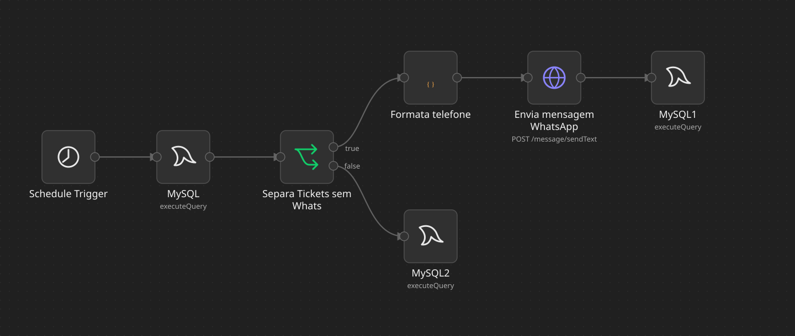
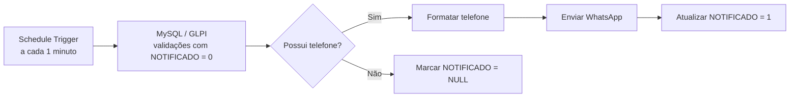

# GLPI Validation WhatsApp Notifier

Automação em n8n para notificação de validações pendentes de chamados do GLPI via WhatsApp.

Em ambientes onde chamados precisam ser validados por usuários específicos, a validação pode ficar pendente quando o responsável não acompanha o GLPI com frequência. Este workflow consulta as validações ainda não notificadas e envia uma mensagem preventiva ao validador que tem telefone cadastrado.

## Como funciona

O Schedule Trigger inicia o fluxo a cada **1 minuto**. Uma consulta MySQL reúne validação, chamado e usuário responsável a partir de `glpi_ticketvalidations`, `glpi_tickets` e `glpi_users`, filtrando `NOTIFICADO = 0`. O nó de condição separa registros com e sem telefone. Para os registros com telefone, um Code node normaliza o número e o HTTP Request envia a mensagem pela API de WhatsApp. Na sequência, o fluxo executa a atualização de `NOTIFICADO`. Sem telefone, executa uma atualização específica para `NULL`.

> **Atenção:** o SQL atual do ramo de envio define `NOTIFICADO = 1` para **todos** os registros que ainda estão em `0`, não apenas para a validação recém-enviada. Essa lógica foi preservada para manter o workflow original. Consulte [melhorias futuras](docs/melhorias-futuras.md) antes de usar em produção.

## Requisitos e configuração

- n8n com nós Schedule Trigger, MySQL, IF, Code e HTTP Request;
- acesso autorizado ao banco MySQL usado pelo GLPI;
- API de WhatsApp compatível com o endpoint `/message/sendText/{instancia}` e autenticação por cabeçalho;
- campo `NOTIFICADO` disponível em `glpi_ticketvalidations`. **Pode ser uma customização do ambiente; não presuma que exista em toda instalação do GLPI.**

1. Importe [o workflow sanitizado](workflows/glpi-validation-notifier.json) no n8n.
2. Configure a credencial MySQL nos três nós MySQL e a credencial HTTP Header Auth no nó de envio.
3. Substitua os marcadores `xxxxxxxxxxxxxxxxxxxx` pela URL da API, instância e endereço base do GLPI da sua instalação **somente no n8n**.
4. Confira as permissões no banco, a existência de `NOTIFICADO` e o comportamento do fluxo em um ambiente de testes antes de ativar o agendamento.
5. Acompanhe as execuções e o resultado dos envios. A condição atual só verifica se o telefone está preenchido; ela não impede o envio de números que o Code node classificou como inválidos.

O arquivo [.env.example](.env.example) enumera configurações necessárias, mas **o workflow atual não lê essas variáveis automaticamente**. Ele mantém credenciais no n8n e marcadores públicos nos campos de URL. A parametrização por ambiente é uma [melhoria futura](docs/melhorias-futuras.md).

## Estrutura

- [Workflow público](workflows/glpi-validation-notifier.json)
- [Arquitetura](docs/arquitetura.md)
- [Fluxo de notificação](docs/fluxo-notificacao.md)
- [Configuração do GLPI](docs/configuracao-glpi.md)
- [Integrações](docs/integracoes.md)
- [Segurança](docs/seguranca.md)
- [Melhorias futuras](docs/melhorias-futuras.md)
- [Exemplo de mensagem](examples/mensagem-exemplo.md)
